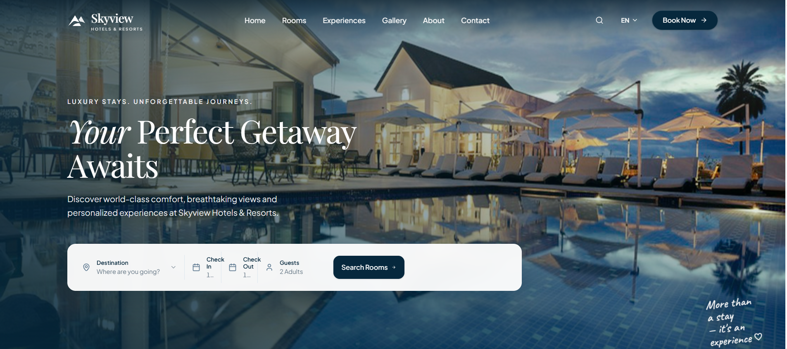

<div align="center">


<a href="https://github.com/GhousDeveloper/Skyview-Hotels-Resorts">
  
</a>

<br />

<kbd>&nbsp;REACT&nbsp;</kbd> &nbsp;•&nbsp; <kbd>&nbsp;TYPESCRIPT&nbsp;</kbd> &nbsp;•&nbsp; <kbd>&nbsp;TAILWIND CSS&nbsp;</kbd> &nbsp;•&nbsp; <kbd>&nbsp;VITE&nbsp;</kbd>

<br /><br />


<br /><br />

**Designed & Developed by [Ghulam Ghous](https://github.com/GhousDeveloper)**

<br />

[Showcase](#-project-showcase) &nbsp;·&nbsp;
[About](#-about-skyview) &nbsp;·&nbsp;
[Features](#-feature-experience) &nbsp;·&nbsp;
[Built With](#%EF%B8%8F-built-with) &nbsp;·&nbsp;
[Design DNA](#-design-dna) &nbsp;·&nbsp;
[Get Started](#-getting-started) &nbsp;·&nbsp;
[Developer](#-behind-the-build)

</div>

<br />

---

# ✨ Project Showcase

<div align="center">

<a href="https://github.com/GhousDeveloper/Skyview-Hotels-Resorts">
  
</a>

<br /><br />

> An immersive luxury hospitality experience combining elegant visual storytelling, interactive resort discovery and a streamlined reservation journey.

</div>

---

# 🏨 About Skyview

**Skyview Hotels & Resorts** is a modern luxury hospitality and resort booking web application designed and developed by **Ghulam Ghous**.

It provides an immersive digital experience for exploring:

<div align="center">

🏝️ **Luxury Resorts** &nbsp;·&nbsp; 🛏️ **Premium Rooms & Suites** &nbsp;·&nbsp; 🏊 **Private Pool Villas** &nbsp;·&nbsp; 🍽️ **Fine Dining**

🧘 **Spa & Wellness** &nbsp;·&nbsp; 🌴 **Curated Experiences** &nbsp;·&nbsp; 📅 **Interactive Reservations**

</div>

---

# ⚡ Feature Experience

| | Experience | Highlights |
|:-:|---|---|
| 🏝️ | **Luxury Hero** | Immersive resort imagery & editorial presentation |
| 📅 | **Booking Engine** | Destination, dates, guests & availability |
| 🛏️ | **Rooms & Suites** | Interactive luxury accommodation catalog |
| 🌍 | **Global Experience** | Multiple languages & currencies |
| 🎁 | **Special Offers** | Countdown & promotional booking flow |
| 🖼️ | **Gallery** | Full-screen resort photography |
| ⭐ | **Testimonials** | Interactive guest reviews |
| 💬 | **Concierge** | 24/7 private guest assistance |

---

## 💎 Crafted Experiences

<table>
  <tr>
    <td width="50%" valign="top">

### 🧘 Spa & Wellness
Relaxation and holistic wellness experiences.

    </td>
    <td width="50%" valign="top">

### 🍽️ Culinary Journey
Premium dining and curated culinary experiences.

    </td>
  </tr>
  <tr>
    <td width="50%" valign="top">

### 🏄 Adventure Tours
Memorable destination activities and adventures.

    </td>
    <td width="50%" valign="top">

### 🌴 Local Culture
Authentic cultural discovery and local experiences.

    </td>
  </tr>
</table>

---

## 🛏️ Accommodation Experience

<table>
  <tr>
    <td width="50%" valign="top">

**Accommodation types**

- Deluxe Room
- Ocean View Suite
- Private Pool Villa
- Family Suite
- Skyview Royal Penthouse
- Cliffside Retreat Bungalow

    </td>
    <td width="50%" valign="top">

**Every stay includes**

- ✔ Room details
- ✔ Occupancy information
- ✔ Bed configuration
- ✔ Resort views
- ✔ Pricing
- ✔ Reservation flow

    </td>
  </tr>
</table>

---

## 🎁 Interactive Features

| Feature | Description |
|---|---|
| ⏱️ **Live Countdown** | Real-time Days / Hours / Minutes / Seconds. |
| 🏷️ **Promotional Booking** | `SKYVIEW30` automatically applies a 30% promotional discount. |
| 💱 **Currency Conversion** | Supports USD, EUR and JPY experiences. |
| 🪟 **Interactive Modals** | Room details, booking, experiences, video, search, gallery and contact experiences. |
| 🔎 **Smart Search** | Fast room and resort experience discovery. |

---

# ⚙️ Built With

<div align="center">


</div>

<br />

| Category | Technologies |
|---|---|
| **Frontend** | React 19, TypeScript |
| **Styling** | Tailwind CSS v4 |
| **Build** | Vite |
| **Icons** | Lucide React |
| **Typography** | Playfair Display · Plus Jakarta Sans · Caveat |

---

## 🎨 Design DNA

Skyview combines **Luxury Hospitality + Coastal Visuals + Editorial Typography + Modern Web Interaction** into a calm, confident and refined interface.

| Swatch | Color | Hex |
|:-:|---|---|
|  | Deep Navy | `#06283D` |
|  | Midnight Navy | `#041C2C` |
|  | Ocean Blue | `#0B5273` |
|  | Soft Blue White | `#F4F8FC` |
|  | Pure White | `#FFFFFF` |
|  | Muted Slate | `#667785` |
|  | Hairline Border | `#DDE7EF` |

---

# 📱 Responsive Experience

<div align="center">

| 💻 DESKTOP | 📟 TABLET | 📱 MOBILE | 🖥️ LARGE DISPLAY |
|:-:|:-:|:-:|:-:|

Navigation, booking interfaces, cards, imagery, modals and typography adapt gracefully across screen sizes.

</div>

---

# 📂 Project Architecture

<details>
<summary><b>📂 View Project Structure</b></summary>

<br />

```text
Skyview-Hotels-Resorts/
│
├── public/
│   └── images/
│
├── src/
│   ├── components/
│   │   ├── Advantages.tsx
│   │   ├── BookingSearch.tsx
│   │   ├── DestinationFeature.tsx
│   │   ├── FeaturedRooms.tsx
│   │   ├── FeatureStrip.tsx
│   │   ├── Footer.tsx
│   │   ├── Hero.tsx
│   │   ├── Modals.tsx
│   │   ├── Navbar.tsx
│   │   ├── ResortImage.tsx
│   │   └── SpecialOffer.tsx
│   │
│   ├── data/
│   │   └── resortData.ts
│   │
│   ├── utils/
│   │   └── resortImages.ts
│   │
│   ├── App.tsx
│   ├── index.css
│   └── main.tsx
│
├── Capture2.PNG
├── index.html
├── package.json
├── tsconfig.json
└── vite.config.ts
```

</details>

---

# 🚀 Getting Started

**1. Clone the repository**

```bash
git clone https://github.com/GhousDeveloper/Skyview-Hotels-Resorts.git
```

**2. Enter the project directory**

```bash
cd Skyview-Hotels-Resorts
```

**3. Install dependencies**

```bash
npm install
```

**4. Start the development server**

```bash
npm run dev
```

> Open the local development URL displayed by Vite in your terminal.

**5. Build for production**

```bash
npm run build
```

---

# 👨‍💻 Behind The Build

<div align="center">

### Ghulam Ghous
**Full-Stack & Frontend Developer**

<br />

> Building modern web applications, polished user interfaces and intelligent digital experiences.

<br />

<a href="https://github.com/GhousDeveloper">
  
</a>

</div>

---

# 📜 License

Licensing information, where provided, is available in the repository's `LICENSE` file.

---

<div align="center">

<br />

**Crafted with ❤️ & ☕ by [Ghulam Ghous](https://github.com/GhousDeveloper)**

<br />

**Skyview Hotels & Resorts**

*Where luxury meets the horizon.*

<br />


</div>
